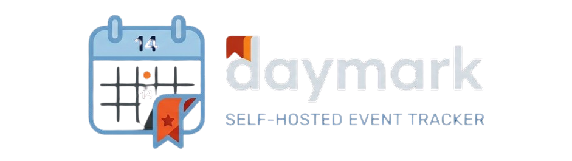

<p align="center">
  
</p>

<h1 align="center">Daymark</h1>

<p align="center">
  <strong>Your self-hosted, privacy-first, mobile-friendly event tracker & countdown board.</strong>
</p>

<p align="center">
  
</p>

---

## 🌟 Key Features

- 📅 **Milestone Tracking**: Seamless countdowns (upcoming events) and count-ups (past events) to monitor exactly how much time remains or has elapsed.
- 📲 **PWA & Mobile-First**: Built from the ground up to render beautifully on mobile browsers. Fully installable as a standalone Progressive Web App.
- 🎨 **Premium Aesthetic**: Modern, responsive glassmorphic dark interface with deep-neon interactive elements, smooth radial orbs, and custom mesh gradients.
- 📱 **Multiple Visual Layouts**: 
  - **List View**: High-density lists with compact status badges.
  - **Card View**: Styled glass container grids with customizable radial gradients.
  - **Poster View**: Vertical Apple Invites-style portrait frames with deep-vignetted custom background image URLs.
- 📝 **Categorization & Custom Icons**: Create custom color-coded categories and select from a flat-grid emoji picker of 64 preset icons.
- 🔒 **Self-Hosted Security**: Protect your data with authorization middleware powered by Next.js and Prisma, backed by an embedded SQLite database stored in a Docker volume.
- 🤖 **Telegram Notifications**: Set up automated event alerts (3, 2, or 1 day(s) before and on the day of the event) delivered directly to your Telegram bot.
- ⏰ **Built-in Reminder Scheduler**: Reminders are checked every minute inside the app process.
- 📦 **Single Container**: App, database and scheduler run in one container with one data volume.

---

## 🚀 Deploying with Docker Compose (Recommended)

Daymark runs as a **single container**: the Next.js app, an embedded SQLite database and the reminder scheduler. The database schema is created or updated automatically on every start.

### Prerequisites

Ensure you have [Docker](https://www.docker.com/) and [Docker Compose](https://docs.docker.com/compose/) installed on your machine.

### Run the Application

1. Copy the `docker-compose.yml` file from this repository to your server or directory.
2. Copy `.env.example` to `.env` and set `JWT_SECRET` to a long random value.
3. Start the container:

```bash
docker compose up -d
```

4. Open your browser and navigate to [http://localhost:1403](http://localhost:1403).

Or without Compose:

```bash
docker run -d --name daymark -p 1403:1403 \
  -e JWT_SECRET=change-me \
  -v daymark_data:/app/data \
  -v daymark_uploads:/app/public/uploads \
  --restart unless-stopped \
  romeolazar/daymark:latest
```

### Backups

All data lives in `/app/data/daymark.db` (the `daymark_data` volume). To take a consistent snapshot while the app is running:

```bash
docker exec daymark node scripts/backup-db.js
docker cp daymark:/app/data/backup-<timestamp>.db ./
```

Stopping the container and copying the volume also works.

---

## ⚙️ Environment Configuration

| Variable | Description | Default |
| :--- | :--- | :--- |
| `APP_PORT` | Host port exposed by Docker Compose. | `1403` |
| `JWT_SECRET` | **Required.** Secret key used for signing session auth tokens. | none |
| `TZ` | Timezone used for reminder times, e.g. `Europe/Bucharest`. | `UTC` |
| `CRON_TOKEN` | Optional. Enables the manual trigger `GET /api/cron?token=...`. Reminders run automatically without it. | empty (disabled) |
| `DATABASE_URL` | SQLite file location. Only change it if you know why. | `file:/app/data/daymark.db` |
| `DISABLE_SCHEDULER` | Set to `true` to turn off the built-in reminder scheduler. | `false` |

---

## ⚙️ App Setup & Telegram Reminders

1. **Initial Admin Onboarding**: When you open [http://localhost:1403](http://localhost:1403) for the first time, you will be redirected to `/register` to create the initial admin account.
2. **Setting Up Telegram Notifications**:
   - Go to your Telegram app and search for `@BotFather`. Follow the prompts to create a new bot and obtain the **Bot Token**.
   - Create a chat or group and retrieve your **Chat ID** (you can use bots like `@userinfobot` to retrieve it).
   - In Daymark, go to **Settings** in the top navigation menu, toggle **Enable Telegram Notifications**, enter your **Bot Token** and **Chat ID**, and click **Save Settings**.
   - Click **Send Test Telegram Message** to verify your setup works instantly!

---

## 🛠️ Development Setup

If you wish to run and modify Daymark locally without Docker:

### 1. Install Dependencies

```bash
npm install
```

### 2. Configure Database & Prisma

Define `DATABASE_URL` (e.g. `file:./dev.db`) and `JWT_SECRET` in a `.env` file, then create the database schema:

```bash
npx prisma db push
npx prisma generate
```

### 3. Run Development Server

```bash
npm run dev
```

The site will be running at [http://localhost:1403](http://localhost:1403). The reminder scheduler starts automatically with the server.
